Your friend challenges you to guess a number that he is thinking.
You guess the number **27**.
He says you are wrong, his number is **26**.

How can you tell if he is telling the truth?
Is there a way to make this 99.99% fair?

---

# Always verify

---

## How do we make a 100% fair guessing game?

---

## Example:

Guess the number I am thinking of, it will be between **1** to **10**!

---

Think of a way to make this more fair.

You only have a budget of **4000 TWD**.

---

How do we make this more fair?

Maybe using a computer also?

---

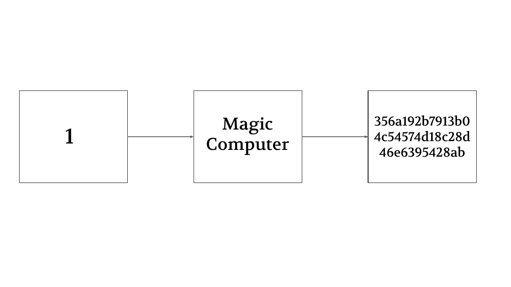

---

---

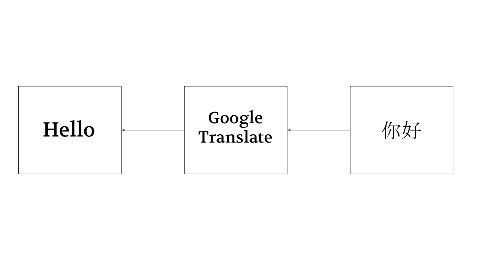

---

---

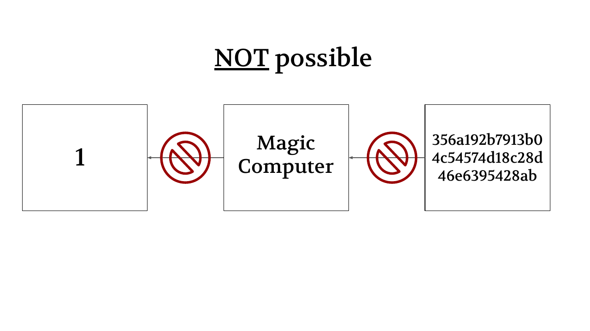

---

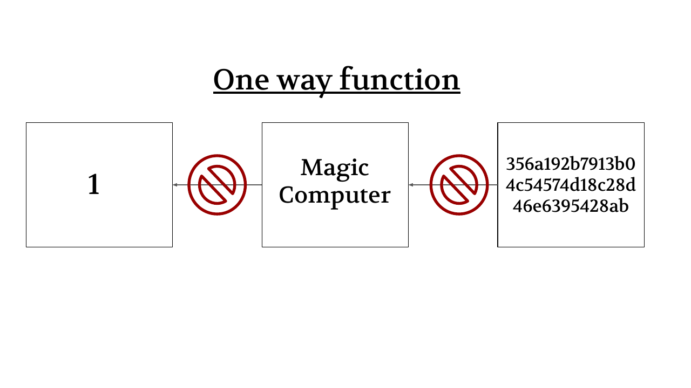

---

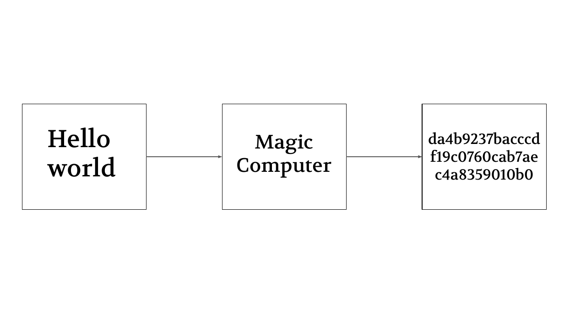

---

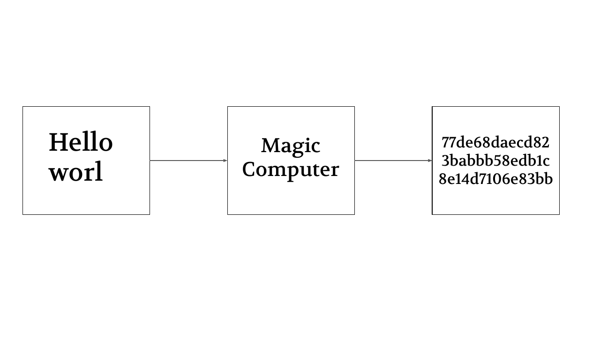

---

---

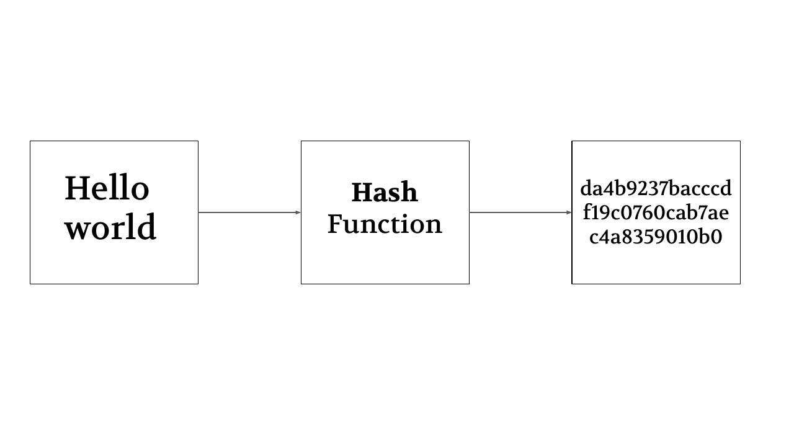

---

## How do we make a 100% fair guessing game?

---

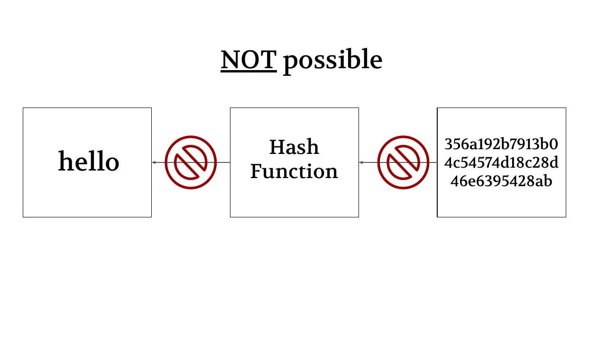

---

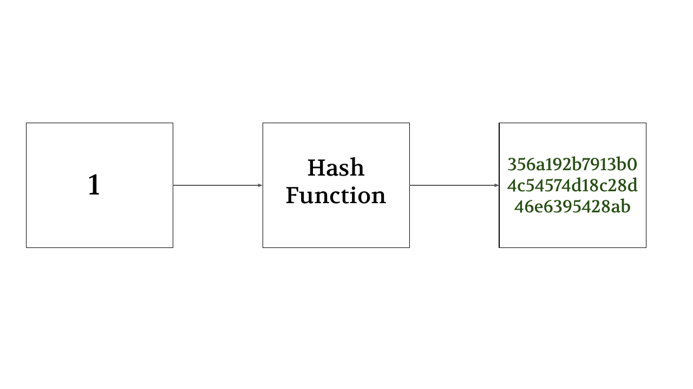

---

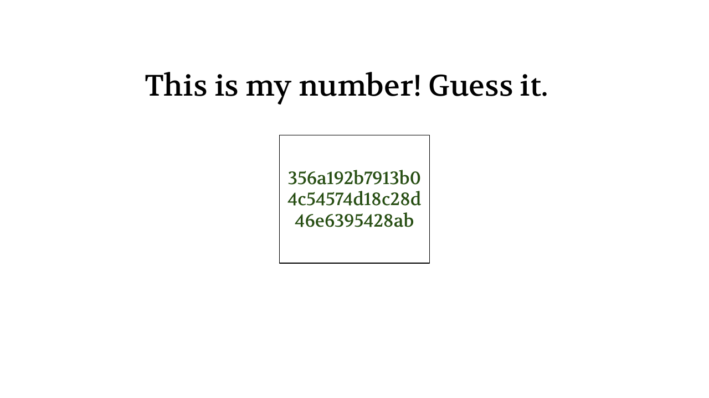

---

---

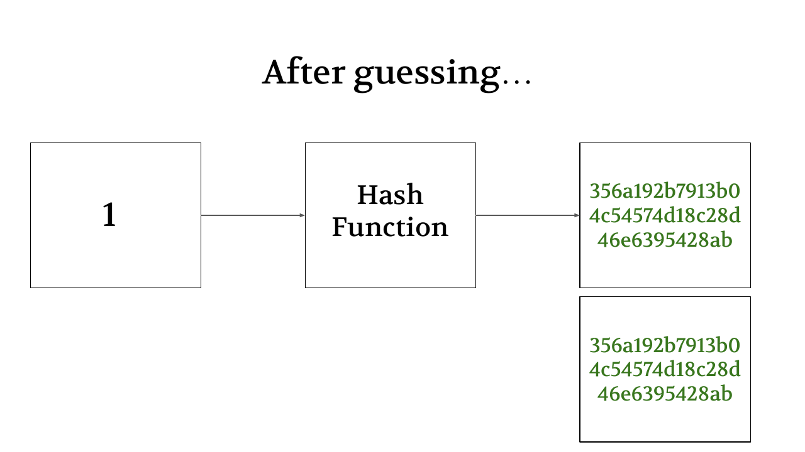

---

## Is there an issue with this method?

---

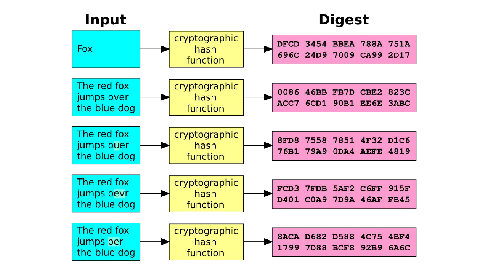

---

## Why is this better than other methods?

---

1. Passwords
2. Checking two documents
3. Cryptocurrency (Bitcoin)

---

## Spot the lie!

1. You need a password to be able to decrypt a hash.
2. You cannot decrypt a hash at all.
3. You can brute force to figure out what the input of a hash is.

---

## Spot the lie!

1. If you are hashing a word, then it will always give the same output for that word.
2. If you given the hash for a specific word, then it is impossible to figure out the word.
3. It is not hard to use a hash function.

---

## Spot the lie!

1. Hash functions are secret and cannot be used by normal people.
2. Hash functions turn an input into a specific output, with the same result every time.
3. Hash functions are one-way, meaning you cannot use the same function to get the input if you are only given the output.

---

## Spot the lie!

1. Hash functions are used by websites to check if you have entered the correct password.
2. There are many hash functions in the world, and they are usually available to use by anyone.
3. If you are given the output of a hash function, you can figure out the input as long as you have access to the hash function.
