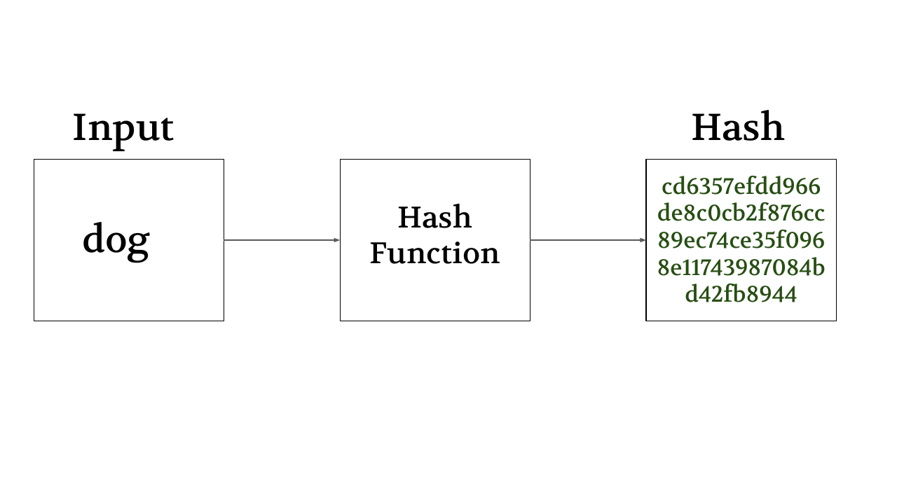
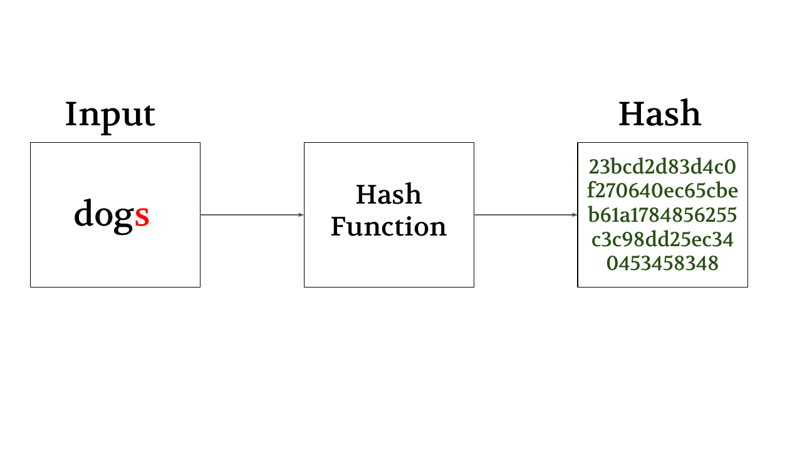
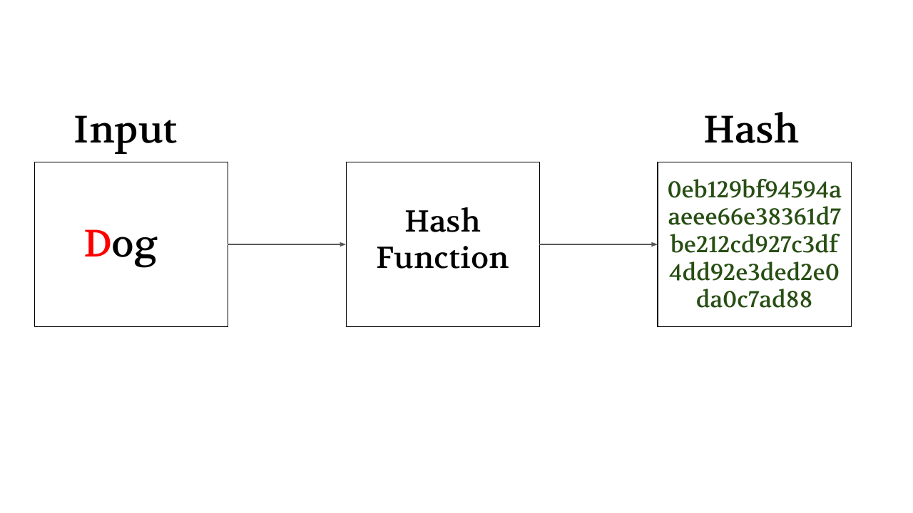
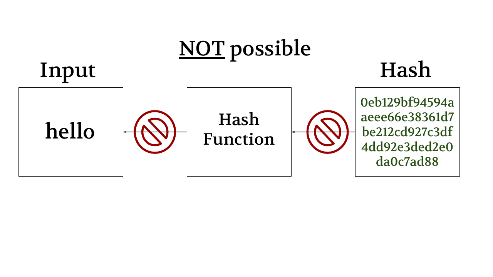
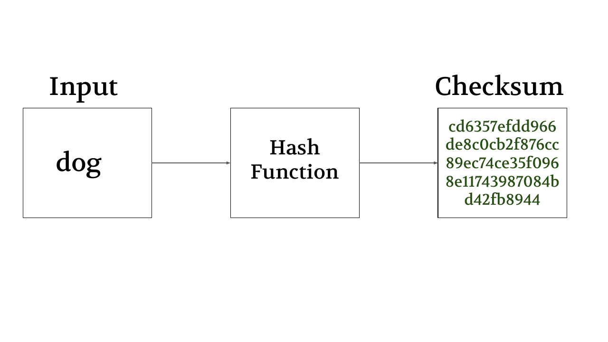

## How do we make a 100% fair guessing game?

---

---

---

---

---

---

## Guess the number from 1 to 12.

---

42d3dff5ccdde44609
f512227decdc5d2565b
d9e61246bde96c95eb
23753efad

---

**five** oct2025

42d3dff5ccdde44609f51
2227decdc5d2565bd9e6
1246bde96c95eb23753ef
ad

---

## Guess the number from 1 to 12.

0aad13e628a3cd999973ef4968
ee862826935c3eb19726eeb3105
93d9f1ebaad

---

## Guess the number from 1 to 12.

0aad13e628a3cd999973ef4968
ee862826935c3eb19726eeb3105
93d9f1ebaad
**ten** manzano2025

---

# Digital Proof

---

## Explain these words:

- Hash
- Checksum
- One-way function

---

# Your friend wants to send you a really important file, and they want to make sure you receive the correct one. How can you use hashing to help ensure that you receive the correct one? You guys can only communicate online, you cannot meet in person. 

---

