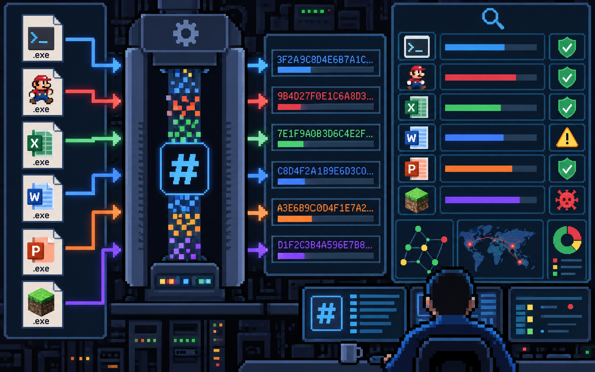

Pair up (or three) and pick a seating.
**Only rule:** You cannot pick the same person and the same seat as last time.

Which sentence is wrong?

1. There was an anomaly with the system, so he went to investigate. 
2. Everything went as expected, so there were a lot of anomalies.
3. Anomalies are sometimes easy to spot.

---

# detecting attacks
or hacking/cheating

---

# baseline

---

# anomaly

---

<!-- llm prompt: anomaly in a school -->

---

# signature
## signature-based

---

<!-- llm prompt: a student typing at a laptop, with a represntation that their typing identifies them (biometrics). -->

---

<!-- llm prompt: executable files (multiple examples: programs, games, office suite) being hashed and their hash values being analyzed -->

---

# detection

---

# prevention

---

<!-- _class: wrong-answer -->
# What is a *baseline*? 

Only submit *creative wrong answers* that your classmates might pick! There will be leaderboard points the more classmates you are able to convince.
<!--question
ask: What is a "baseline"?
answer: An established normal behavior. 
-->

---

<!-- _class: best-answer -->
# What is a *baseline*? 

Based from what you've learned, write the best *correct answer* that you can do.

<!--question
ask: What is a "baseline"?
answer: An established normal behavior.
-->

---

<!-- _class: wrong-answer -->
# What is an *anomaly*? 

Only submit *creative wrong answers* that your classmates might pick! There will be leaderboard points the more classmates you are able to convince.
<!--question
ask: What is an "anomaly"?
answer: Something that is not following the baseline.
-->

---

<!-- _class: best-answer -->
# What is an *anomaly*? 

Based from what you've learned, write the best *correct answer* that you can do.

<!--question
ask: What is an "anomaly"?
answer: Something that is not following the baseline.
-->

---

<!-- _class: wrong-answer -->
# What is the difference between detection and prevention?

Only submit *creative wrong answers* that your classmates might pick! There will be leaderboard points the more classmates you are able to convince.
<!--question
ask: What is the difference between detection and prevention?
answer: Detection only tells you, prevention stops it for you.
answer: Detection only spots attacks, prevention stops attacks.
-->

---

<!-- _class: best-answer -->
# What is the difference between detection and prevention?

Based from what you've learned, write the best *correct answer* that you can do.

<!--question
ask: What is the difference between detection and prevention?
answer: Detection only tells you, prevention stops it for you.
answer: Detection only spots attacks, prevention stops attacks.
-->

---
