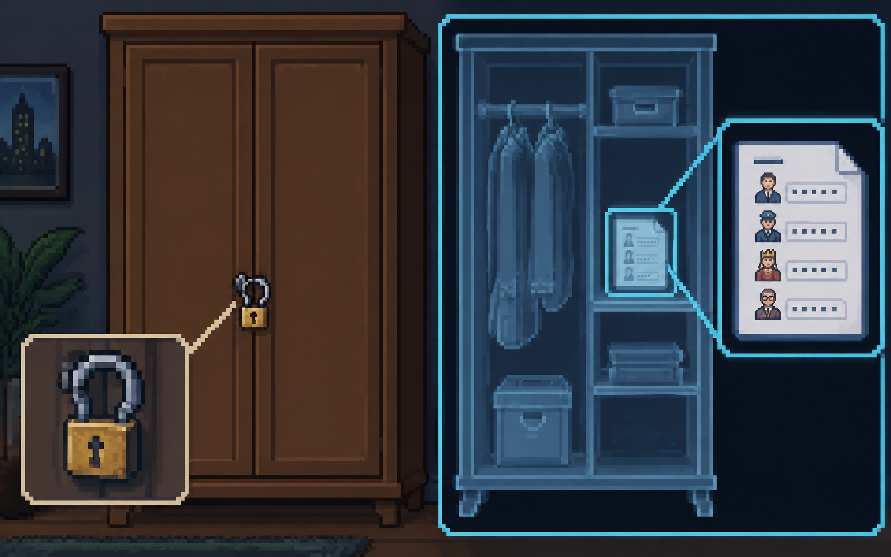
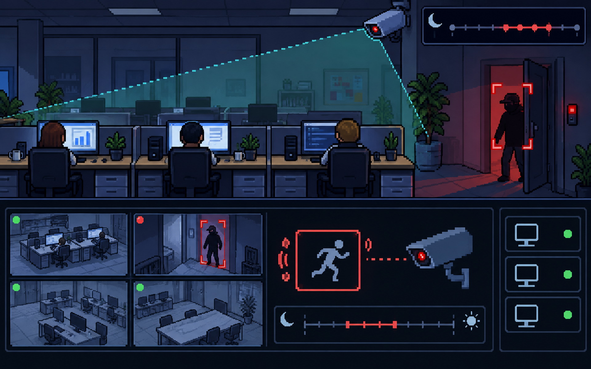
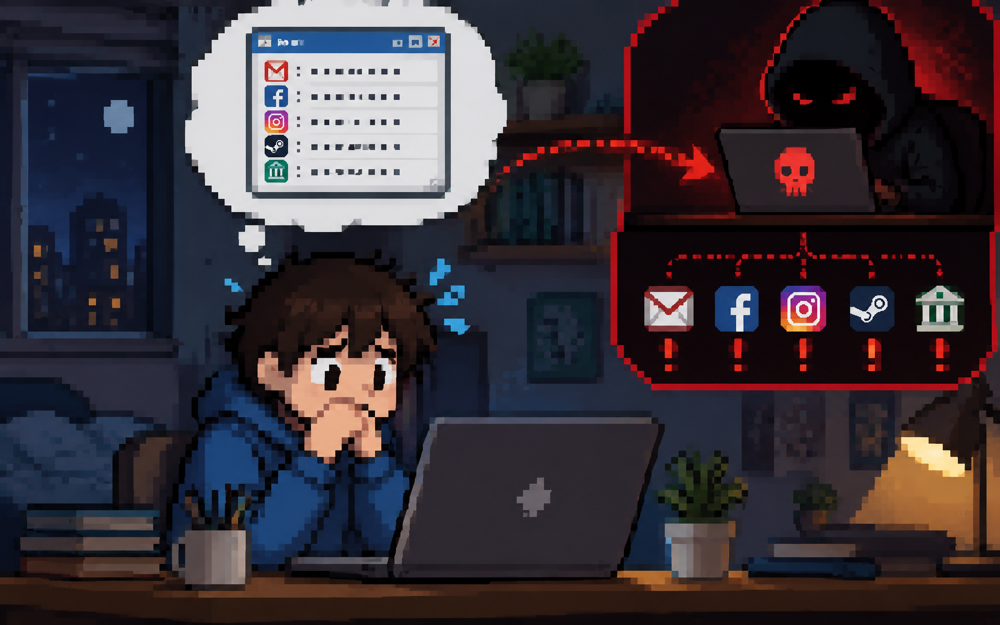

<!-- _class: wrong-answer -->
# What is a private IP address?

Only submit *creative wrong answers* that your classmates might pick! There will be leaderboard points the more classmates you are able to convince.
<!--question
answer: It is an identifier that is given to a device once it connects to the router. 
answer:

answer:
-->

---

<!-- _class: best-answer -->
# What is an IP address?

Based from what you've learned, write the best *correct answer* that you can do.

<!--question
answer: It is the gathering of information to help find weaknesses.
-->

---

# What would be the downside of not doing *reconnaissance*?

---

# When would *persistence* not be neccessary?

---

# Why is *lateral movement* necessary in some attacks?

--- 

# What is the importance of knowing the types of *adversaries*?

---

# What is *"risk assessment"*?

---

<!-- llm prompt: A fortress with a lot of heavily armed guards protecting something ridiculously low value - which is a flash drive of movies -->

---

<!-- llm prompt: A closet with a flimsy padlock, and we have an x-ray view showing that it contains a paper that contains the passwords of important people. -->

---

<!-- llm prompt: CCTV (camera) security measures watching over employee computers, with motion detection at certain times to alert if someone enters -->

---

# Why do we do *risk assessment*?

---

# How do we do *risk assessment*?
1. 1 to 10
2. "Around 10,000 TWD"
3. Low impact, medium impact, high impact

---

## What are the assets?
## What are the likely threats?
## Details on how it can be hacked

---

# Avoid

---

# Transfer

---

# Mitigate

---

# Accept

--- 

<!-- llm prompt: A student who is worried about the passwords in their laptop being hacked since they just list it down in a text file. -->

---

## Scenario: A student is concerned about the passwords that they have stored in their laptop in a text file.

# How do we *avoid*?

---

## Scenario: A student is concerned about the passwords that they have stored in their laptop in a text file.

# How do we *transfer*?

---

## Scenario: A student is concerned about the passwords that they have stored in their laptop in a text file.

# How do we *mitigate*?

---

## Scenario: A student is concerned about the passwords that they have stored in their laptop in a text file.

# How do we *accept*?

---
