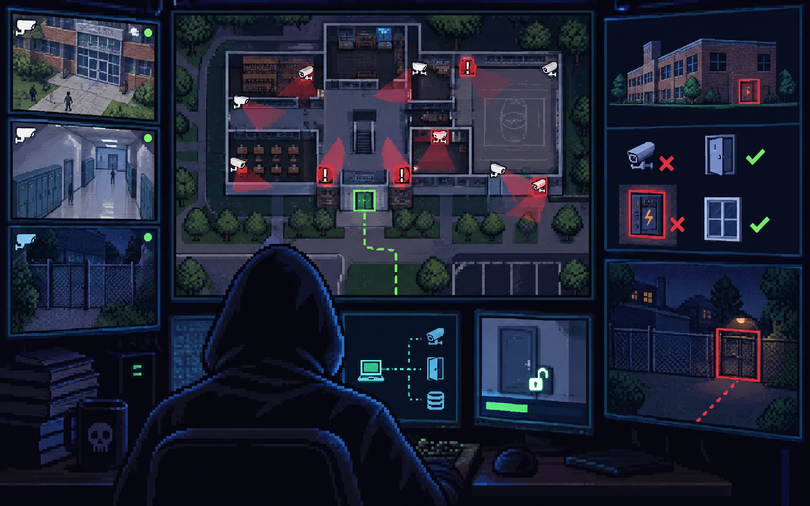
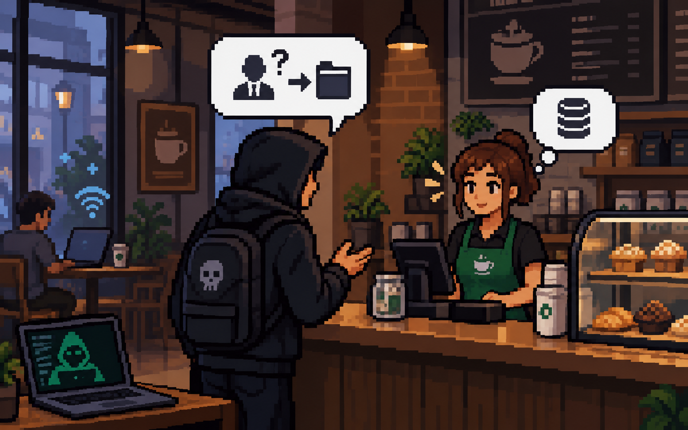
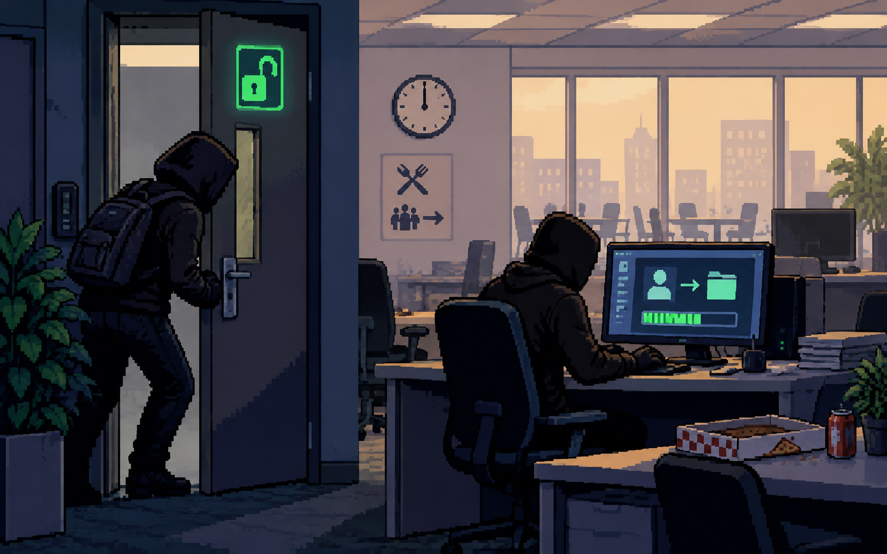
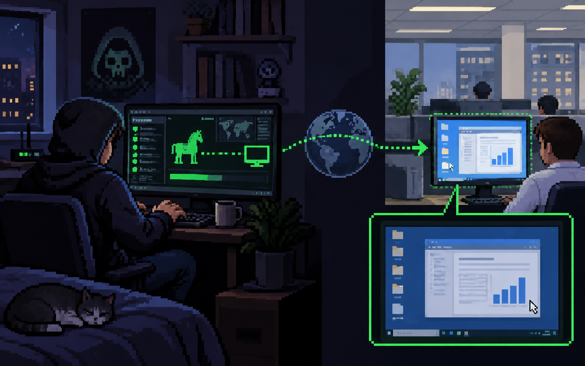
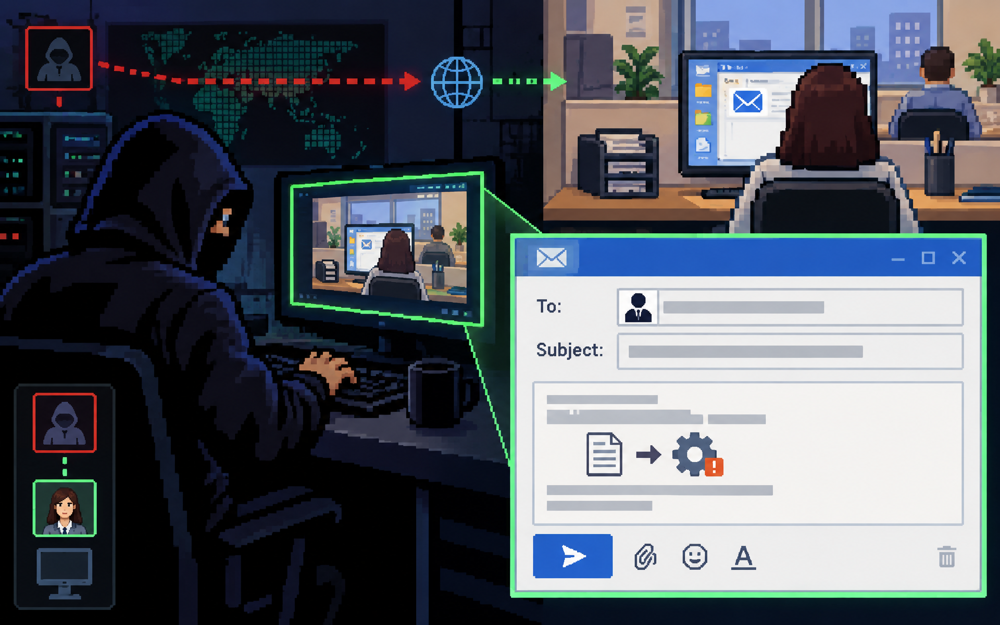
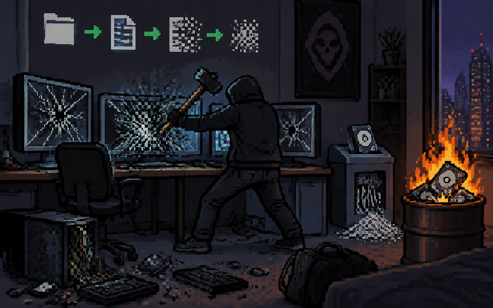

# full hacking process

---

# full cyberattack process

---

# adversaries

---

<!-- llm prompt: different types of adversaries in cybersecurity (ex. script kiddies, hacktivists, cyberterrorists) -->

---

# script kiddies

---

# low skilled

---

# high skilled

---

# low skilled vs high skilled

---

# hacktivists

---

# insider adversaries 

---

# cyberterrorists

---

# transnational criminal organizations

---

## Give me 2 examples of specific adversaries and what makes them unique

---

## Why do we need to know these names and types?

---

# asset

---

- Teacher
- Student
- President
- Policeman
- Parents

---

## how do high skilled adversaries do it?

---

# reconnaissance

---

<!-- llm prompt: a hacker trying to scout out a school to see where the weakpoints are -->

---

<!-- llm prompt: a hacker trying to talk to an employee at a coffee shop to gain information -->

---

## why do they need to do reconnaissance?

---

# initial access

---

<!-- llm prompt: a hacker using an unlocked office backdoor to gain access to a computer during lunch break -->

---

# persistence

---

<!-- llm prompt: a hacker at home accessing an office computer that he hacked using a remote access trojan. -->
---

# "lateral" movement

---

<!-- llm prompt: A hacker writing an email to an administrator while he is impersonating an office staff (the hacker is using their computer remotely). -->
---

# taking-action

---

# evading detection

---

<!-- llm prompt: A hacker destroying his computers so that he leaves no trace behind -->
---

# risk assessment

---

## How do I protect an asset?
