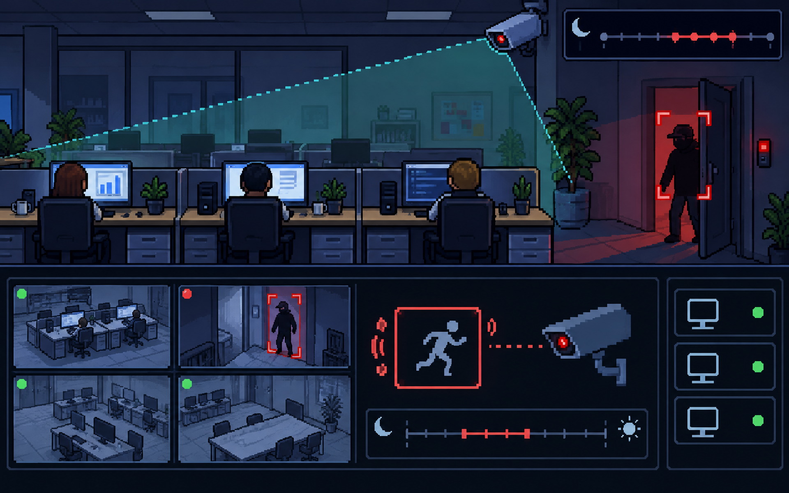

Pair up (or three) and pick a seating.
**Only rule:** You cannot pick the same person and the same seat as last time.
If you don't feel like participating today, just go to the back to quietly have free time.

As a pair, find the lie.

1. Reconnaissance is necessary to be able to hack an organization. 
2. Persistence is not always necessary.
3. You don't have to worry about all types of adversaries.

---

# What is *reconnaissance*? 

---

# What would be the downside of not doing *reconnaissance*?

---

# When would *persistence* not be neccessary?

---

# Why is *lateral movement* necessary in some attacks?

--- 

# What is the importance of knowing the types of *adversaries*?

---

# What is *"risk assessment"*?

---

<!-- llm prompt: A fortress with a lot of heavily armed guards protecting something ridiculously low value - which is a flash drive of movies -->

---

<!-- llm prompt: A closet with a flimsy padlock, and we have an x-ray view showing that it contains a paper that contains the passwords of important people. -->

---

<!-- llm prompt: CCTV (camera) security measures watching over employee computers, with motion detection at certain times to alert if someone enters -->

---

# Why do we do *risk assessment*?

---

# How do we do *risk assessment*?
1. 1 to 10
2. "Around 10,000 TWD"
3. Low impact, medium impact, high impact

---

## What are the assets?
## What are the likely threats?
## Details on how it can be hacked

---

# Avoid

---

# Transfer

---

# Mitigate

---

# Accept

--- 

<!-- llm prompt: A student who is worried about the passwords in their laptop being hacked since they just list it down in a text file. -->

---

## Scenario: A student is concerned about the passwords that they have stored in their laptop in a text file.

# How do we *avoid*?

---

## Scenario: A student is concerned about the passwords that they have stored in their laptop in a text file.

# How do we *transfer*?

---

## Scenario: A student is concerned about the passwords that they have stored in their laptop in a text file.

# How do we *mitigate*?

---

## Scenario: A student is concerned about the passwords that they have stored in their laptop in a text file.

# How do we *accept*?

---
