Your friend challenges you to guess a number that he is thinking.
You guess the number **27**.
He says you are wrong, his number is **26**.

How can you tell if he is telling the truth?
Is there a way to make this 99.99% fair?

---

# Always verify

---

## How do we make a 100% fair guessing game?

---

## Example:

Guess the number I am thinking of, it will be between **1** to **10**!

---

Think of a way to make this more fair.

You only have a budget of **4000 TWD**.

---

How do we make this more fair?

Maybe using a computer also?

---

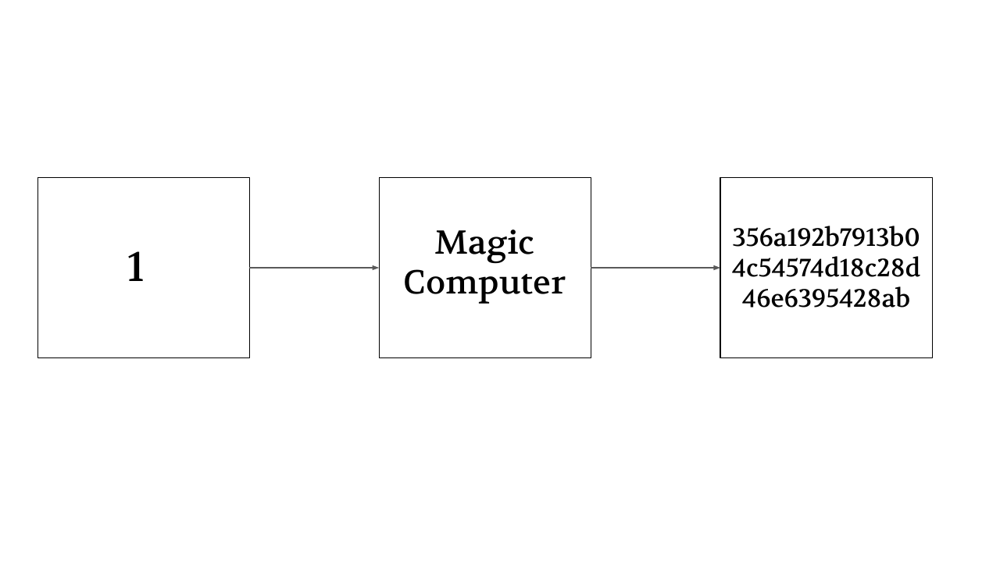

---

---

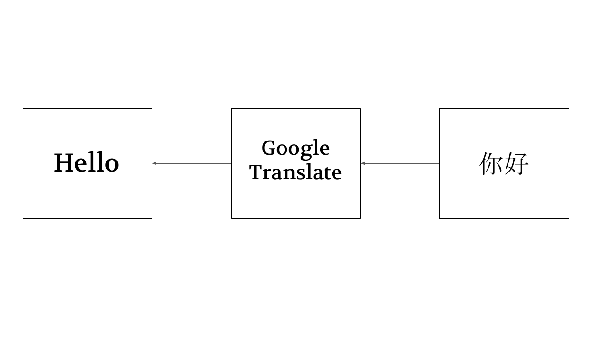

---

---

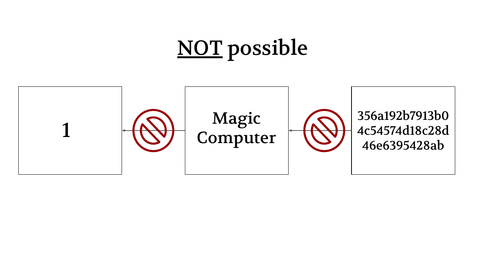

---

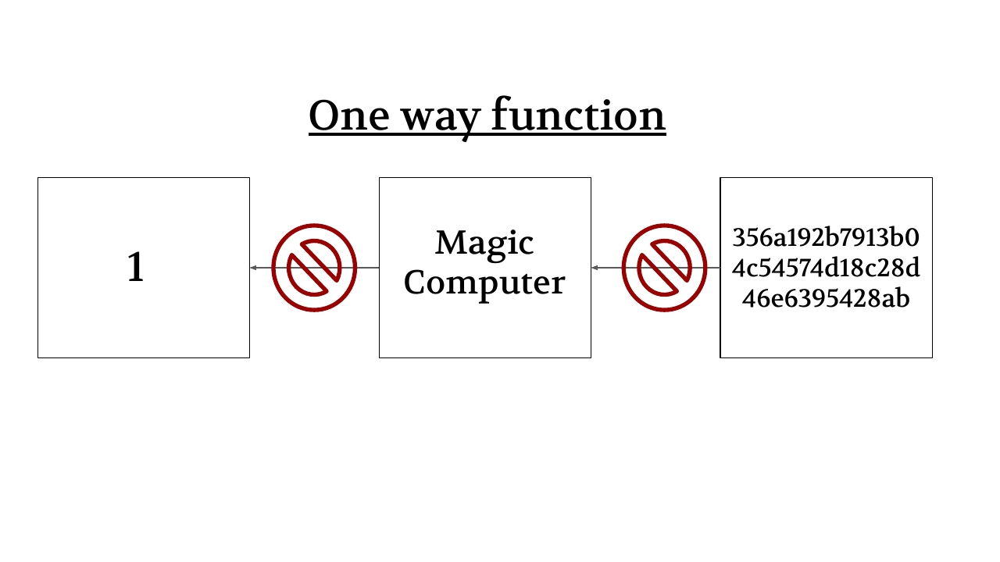

---

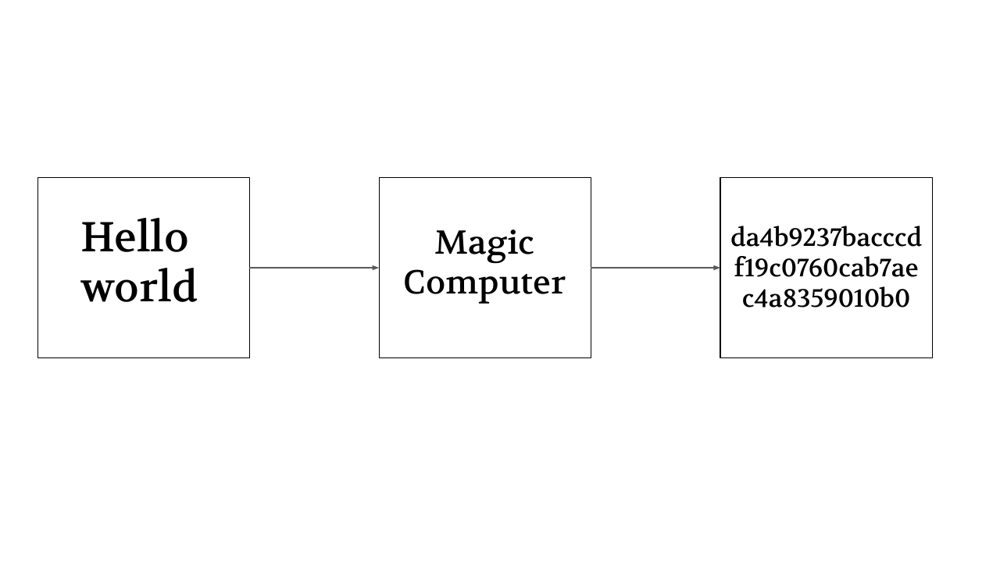

---

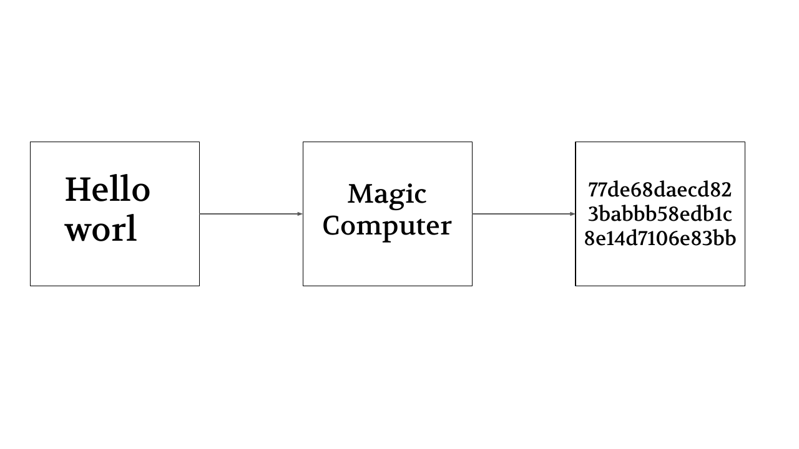

---

---

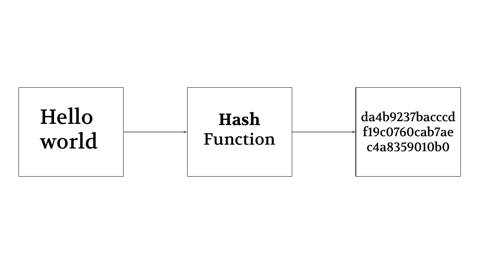

---

## How do we make a 100% fair guessing game?

---

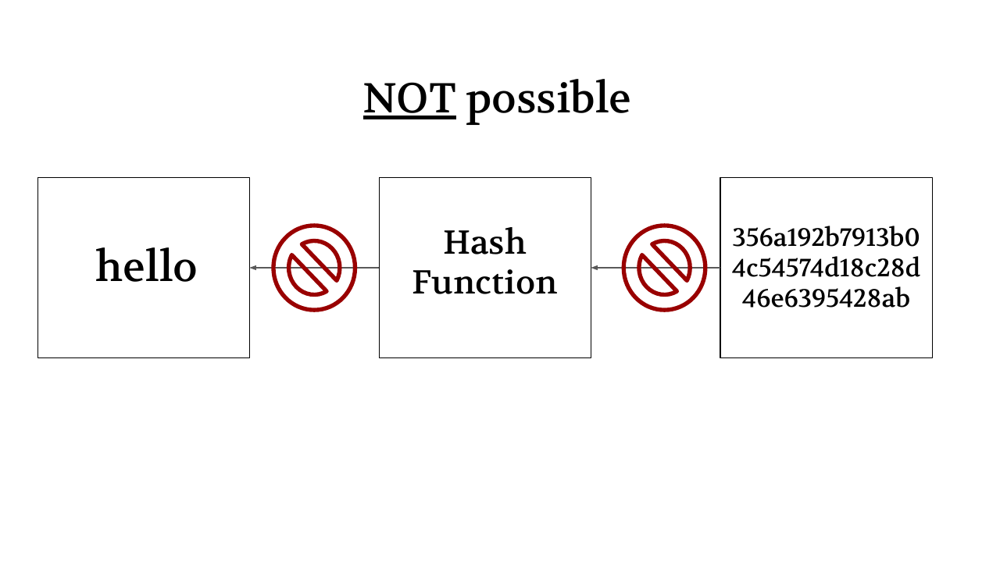

---

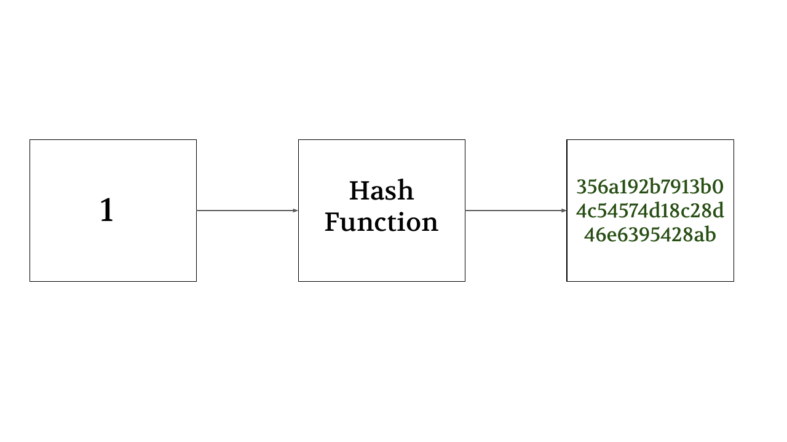

---

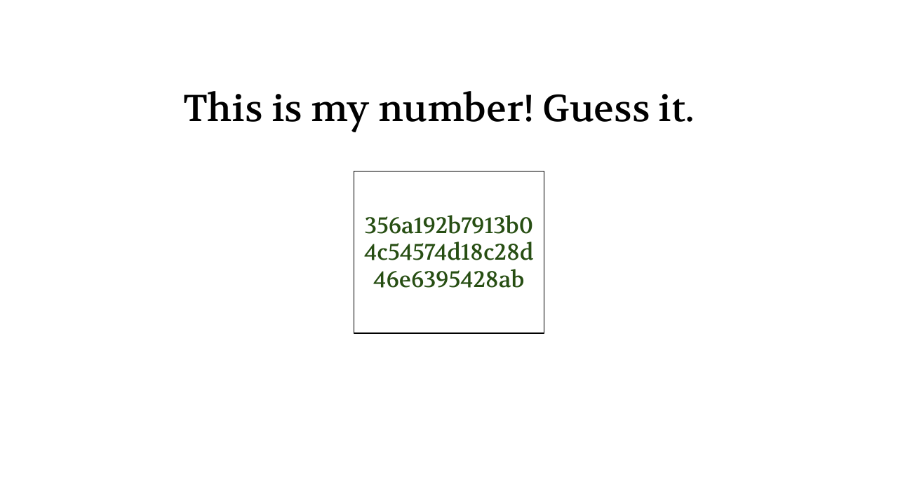

---

---

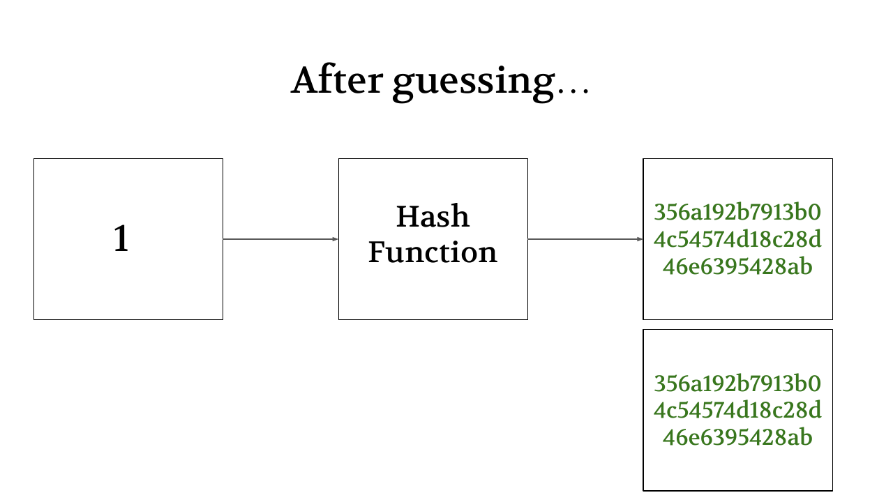

---

## Is there an issue with this method?

---

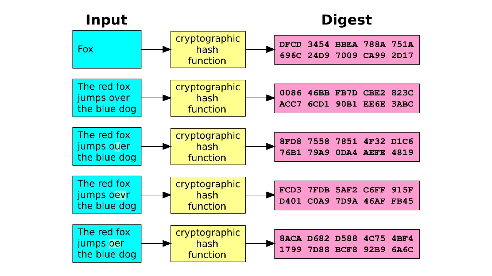

---

## Why is this better than other methods?

---

1. Passwords
2. Checking two documents
3. Cryptocurrency (Bitcoin)

---

## Spot the lie!

1. You need a password to be able to decrypt a hash.
2. You cannot decrypt a hash at all.
3. You can brute force to figure out what the input of a hash is.

<!-- question
ask: Which statement about hashes is false?
answer: A
-->

<!--
Why: A hash has no password or key, because it isn't encryption. It can only be attacked by hashing guesses and comparing the outputs.
Watch for:
- Confuses hashing with encryption, so expects a password or key
- Thinks brute force can't work because hashes can't be decrypted
-->

---

## Spot the lie!

1. If you are hashing a word, then it will always give the same output for that word.
2. If you given the hash for a specific word, then it is impossible to figure out the word.
3. It is not hard to use a hash function.

<!-- question
ask: Which statement about hashes is false?
answer: B
-->

<!--
Why: A hash can't be reversed, but a word can still be found by hashing guesses until one matches.
Watch for:
- Treats one-way as meaning the input can never be found
- Thinks a word could hash to a different output each time
-->

---

## Spot the lie!

1. Hash functions are secret and cannot be used by normal people.
2. Hash functions turn an input into a specific output, with the same result every time.
3. Hash functions are one-way, meaning you cannot use the same function to get the input if you are only given the output.

<!-- question
ask: Which statement about hash functions is false?
answer: A
-->

<!--
Why: Common hash functions are public and anyone can use them. Their safety comes from being one-way, not from being secret.
Watch for:
- Thinks the security of a hash depends on keeping the function secret
-->

---

## Spot the lie!

1. Hash functions are used by websites to check if you have entered the correct password.
2. There are many hash functions in the world, and they are usually available to use by anyone.
3. If you are given the output of a hash function, you can figure out the input as long as you have access to the hash function.

<!-- question
ask: Which statement about hash functions is false?
answer: C
-->

<!--
Why: Having the function doesn't let you run it backwards, because hash functions are one-way.
Watch for:
- Thinks a hash function can be run in reverse like a decryption
- Doesn't connect comparing password hashes at login to how websites check passwords
-->
