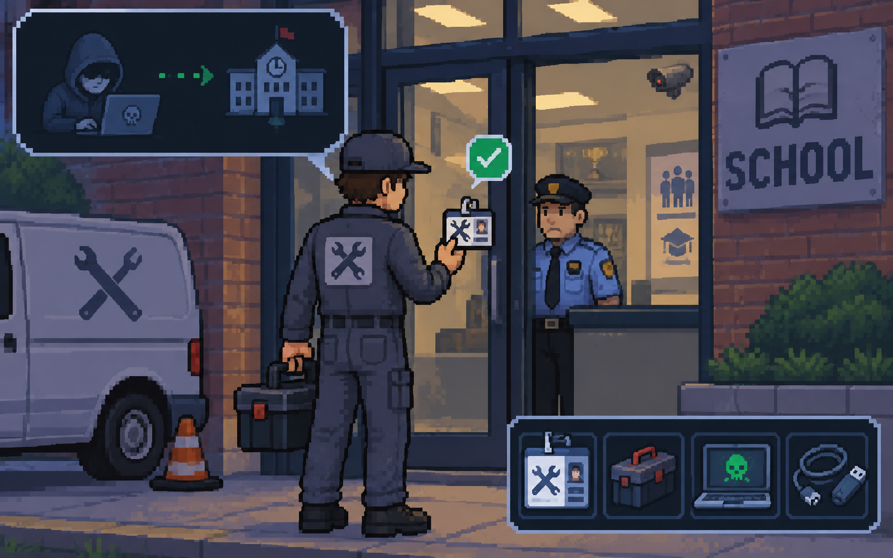

# social engineering

---

# pretexting

---

# (pre)(texting)

---

<!-- llm prompt: a hacker trying to get into a school by pretending to be a maintenance guy -->

---

<!-- llm prompt: a hacker pretending to be an academic affairs officer at a school, contacting a student to ask for their password (computer to computer) -->

---

# consensus

---

# scarcity

---

# familiarity

---

# urgency

---
