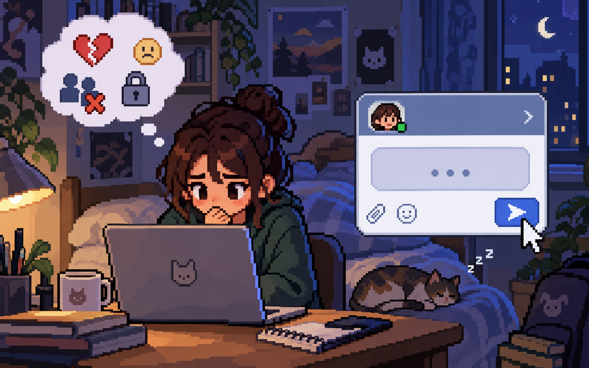
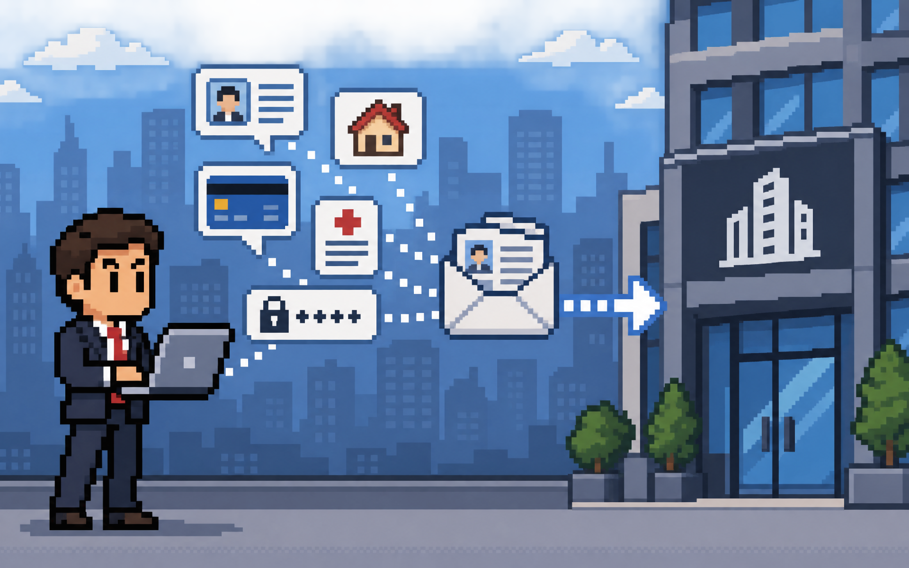
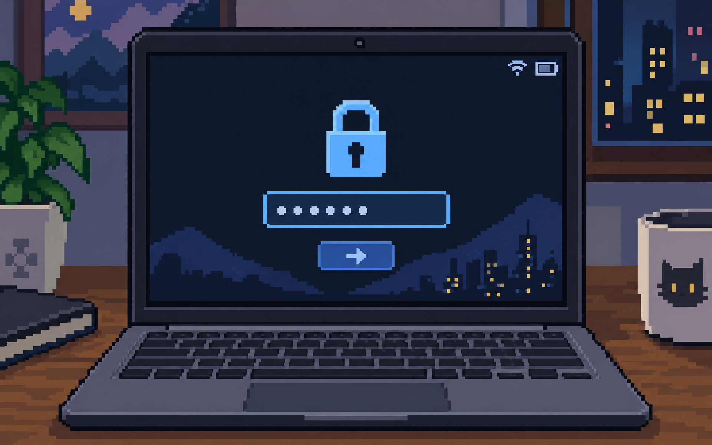

**Only rule:** You cannot pick the same seat as last time.

Which is a *wrong* idea?

1. We do risk transference to save money. 
2. We do risk mitigation to reduce the risk of hacking. 
3. We do risk avoidance to save resources.

---

# risk assessment

---

## avoid
## transfer
## **mitigate**
## accept

---

# security controls
- cameras
- firewalls
- encryption
- guards

---

## What are we protecting with these *security controls*?

---

## **confidentiality**
## integrity
## availability

---

<!-- llm prompt: A student wanting to send a sensitive message to a friend. -->
---

<!-- llm prompt: A businessman wanting to send their personal information (sensitive information) to a business. -->

---

<!-- llm prompt: A password screen on a laptop to stop unauthorized people from getting in. -->

---

<!-- _class: wrong-answer -->

## What is confidentiality?

<!--question
ask: What is confidentiality?
answer: It is protecting information or access so that it is not seen or used by unauthorized people. 
-->

---

<!-- _class: best-answer -->

## What is confidentiality?

<!--question
ask: What is confidentiality?
answer: It is protecting information or access so that it is not seen or used by unauthorized people. 
-->

---

# cryptography
## encryption
## decrypt

---

## How can you send sensitive messages to trusted people without bad people seeing it?

---

## asymmetric cryptography

---

# fin

---
