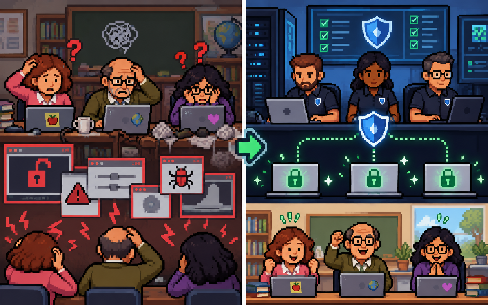

**Only rule:** You cannot pick the same seat as last time.

Which is a *wrong* idea?

1. We do risk assessment to protect from all attacks. 
2. We do risk assesssment to protect the asset.
3. We do risk assessment to protect from some attacks.

---

# adversaries

---

## social engineering
## different attacks
## ideas for protecting

---

# proper risk assessment

---

## avoid
## transfer
## mitigate
## accept

---

# risk avoidance

---

Scenario: A school wants to protect their credentials to their main student database. They usually store it in work laptops.
- Bring the work laptops outside of school
- Use the work laptops for day-to-day work
- Connecting work laptops to the internet

---

<!-- llm prompt: A contrast between bringing work laptops around compared to having desktop at work. -->

---

<!-- _class: wrong-answer -->
Scenario: A school stores their exams on their school server (digital) so that it can be accessed online and wants to do some risk assessment.

How can they do risk avoidance?

<!--question
ask: How can a school do risk avoidance on this scenario: storing exams digitally on a school server.
answer: Just have the exams on paper, don't store it on the school server.
answer: Have the server fully offline and only allow physical access.
-->

---

<!-- _class: best-answer -->

Scenario: A school stores their exams on their school server (digital) so that it can be accessed online and wants to do some risk assessment.

How can they do risk avoidance?

<!--question
ask: How can a school do risk avoidance on this scenario: storing exams digitally on a school server.
answer: Just have the exams on paper, don't store it on the school server.
answer: Have the server fully offline and only allow physical access.
-->

---

# risk transfer (transference)

---

Scenario: A school wants to protect their credentials to their main student database. They usually store it in work laptops.

---

<!-- llm prompt: A contrast between non-technical teachers trying to secure their own laptops versus getting a competent security company to do it for them. -->

---

<!-- _class: wrong-answer -->
Scenario: A school allows students to take their exams remotely. 

How can they do risk transfer?

<!--question
ask: How can a school do risk transfer on this scenario: allowing students to take their exams remotely.
answer: They hire a third-party service to help secure their remote exam procedures.
answer: They get a security company to do anti-cheating measures for their exams.
-->

---

<!-- _class: best-answer -->

Scenario: A school allows students to take their exams remotely. 

How can they do risk transfer?

<!--question
ask: How can a school do risk transfer on this scenario: allowing students to take their exams remotely.
answer: They hire a third-party service to help secure their remote exam procedures.
answer: They get a security company to do anti-cheating measures for their exams.
-->
---

# mitigation

---

# security controls
- cameras
- firewalls
- encryption
- guards

---

<!-- _class: best-answer -->

Scenario: A school stores their exams on their school server (digital) so that it can be accessed online and wants to do some risk assessment.

How can they do risk mitigation?

<!--question
ask: How can a school do risk mitigation on this scenario: storing their exams on their school server digitally.
answer: Add a well-configured firewall to prevent intrusion.
answer: Add cameras around the school server to not allow unauthorized physical access.
-->
---

# risk acceptance

---
<!-- _class: wrong-answer -->
Scenario: Your phone. It has almost everything. You take it everywhere. 

How do we do: risk avoidance?

<!--question
ask: How can you do risk avoidance in this scenario: Protecting your phone, which has almost everything. You usually bring it everywhere.
answer: Leaving your phone at home most of the time.
answer: Having two phones instead, leave the most important one at home.
-->
---
<!-- _class: best-answer -->
Scenario: Your phone. It has almost everything. You take it everywhere. 

How do we do: risk avoidance?

<!--question
ask: How can you do risk avoidance in this scenario: Protecting your phone, which has almost everything. You usually bring it everywhere.
answer: Leaving your phone at home most of the time.
answer: Having two phones instead, leave the most important one at home.
-->
---
<!-- _class: wrong-answer -->
Scenario: Your phone. It has almost everything. You take it everywhere. 

How do we do: risk transfer?

<!--question
ask: How can you do risk transfer in this scenario: Protecting your phone, which has almost everything. You usually bring it everywhere.
answer: Adding a software from a security company that controls and protects your phone for you. 
answer: Having someone else take care of it for you.
-->
---
<!-- _class: best-answer -->
Scenario: Your phone. It has almost everything. You take it everywhere. 

How do we do: risk transfer?

<!--question
ask: How can you do risk transfer in this scenario: Protecting your phone, which has almost everything. You usually bring it everywhere.
answer: Adding a software from a security company that controls and protects your phone for you. 
answer: Having someone else take care of it for you.
-->
---
<!-- _class: wrong-answer -->
Scenario: Your phone. It has almost everything. You take it everywhere. 

How do we do: risk mitigation?

<!--question
ask: How can you do risk mitigation in this scenario: Protecting your phone, which has almost everything. You usually bring it everywhere.
answer: Installing antivirus software in your phone. 
answer: Turning on software that allows you to track your phone if it is lost.
-->
---
<!-- _class: best-answer -->
Scenario: Your phone. It has almost everything. You take it everywhere. 

How do we do: risk mitigation?

<!--question
ask: How can you do risk mitigation in this scenario: Protecting your phone, which has almost everything. You usually bring it everywhere.
answer: Installing antivirus software in your phone. 
answer: Turning on software that allows you to track your phone if it is lost.
-->
---

<!-- _class: wrong-answer -->

## What is the main difference between *risk transference* and *risk mitigation*?

<!--question
ask: What is the main difference between *risk transference* and *risk mitigation*?
answer: Transfer means someone else is doing the security improvements. Mitigation means you are doing it yourself. 
answer: If something gets hacked, "risk transference" means someone else is responsible for it.
-->

---

<!-- _class: best-answer -->

## What is the main difference between *risk transference* and *risk mitigation*?

<!--question
ask: What is the main difference between *risk transference* and *risk mitigation*?
answer: Transfer means someone else is doing the security improvements. Mitigation means you are doing it yourself. 
answer: If something gets hacked, "risk transference" means someone else is responsible for it.
-->

---

# fin

---
