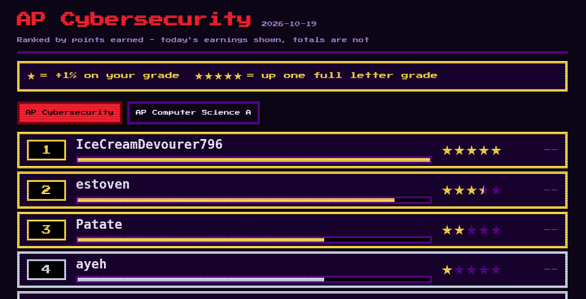
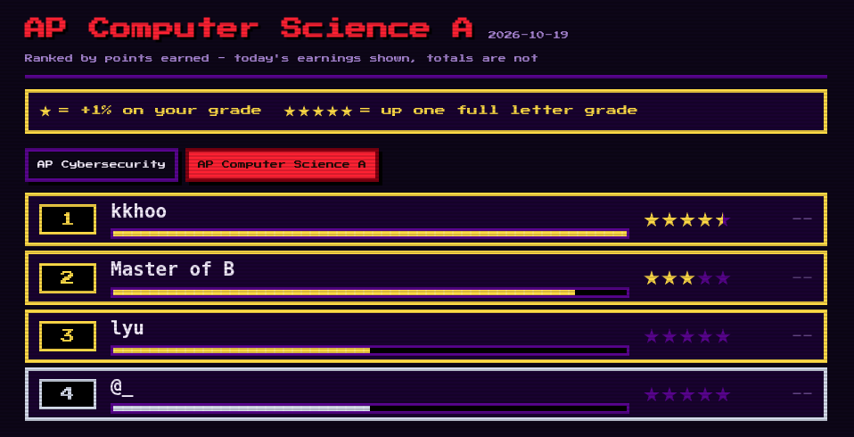

<!-- _class: options -->


1. 7 / 2 == 3
2. (1 + "2" + 3) == "123"
3. "computer".substring(2, 5) == "mput"

---

<!-- _class: options-long -->


1. A website sees the public IP address of the network you use. This is so it can know which internet is connecting.
2. A website can see the private IP address of your device. This is so it can know which device is connecting.
3. An IP address alone does not tell you who a person is. You need help from police or IT to figure it out.

---



---

```
public class Main {
	public static void main(String[] args) {
		System.out.println("Hello world!");
	}
}
```

---



---

<!-- _class: section -->

# <!-- fit --> “Not graded”

---

# <!-- fit --> Leaderboard Points

---

# <!-- fit --> Privilege *or* Benefits

---

<!-- _class: section -->

# <!-- fit --> “Graded”

---

# <!-- fit --> Unit Tests

---

# <!-- fit --> Exams

---

# <!-- fit --> Safe Exam Browser

---

# <!-- fit --> 5 minutes after class starts

---

# <!-- fit --> Tardy *+* No Points

---

# <!-- fit --> Google Classroom

---

# <!-- fit --> Self Study Resources

---

<!-- _class: question -->

# What are leaderboard points for and how do I get them?

---

<!-- _class: question -->

# How do I get an A+ in this class?

---

<!-- _class: question -->

# What should I do once the bell rings?

---

<!-- _class: question -->

# When will I get marked late or tardy?

---

<!-- _class: topic -->

# Gimkit

Every 10 correct answers is 1 point.

Winners get bonus points.
