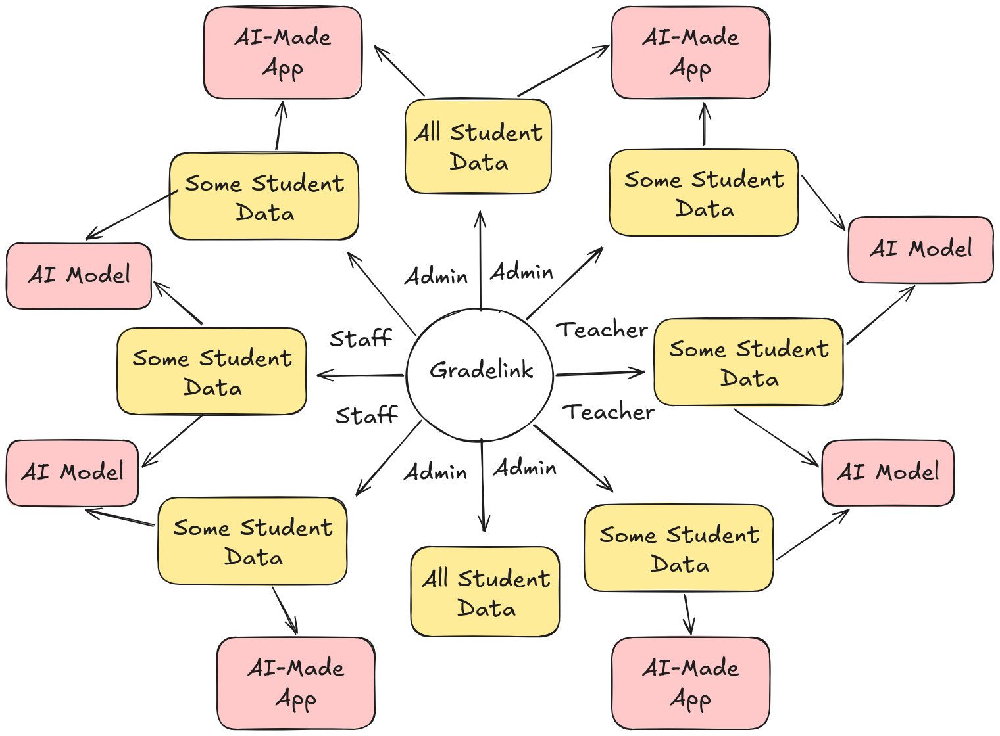
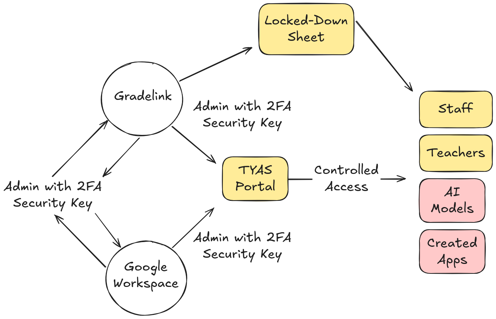
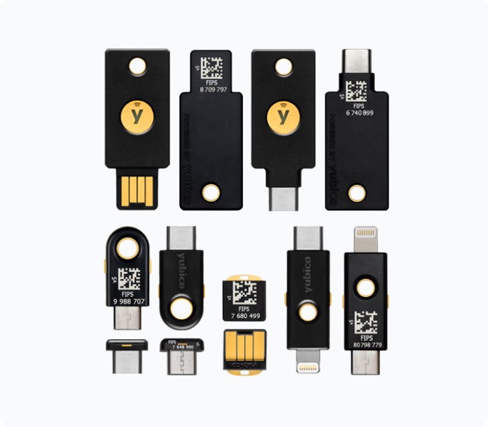

# TYAS Security

Practical improvements, based on the past year

<!--
Not comprehensive. A more detailed technical security report is available on request.
-->

---

# Threat model

What is likely to happen, with some impact

- Student data shared in a Google Sheet
- Gradelink admin account compromised
- Google Workspace admin account compromised
- Teacher account compromised
- Student data used to train AI, or exposed via a hacked ChatGPT/Claude account

---

---

---

---

# Core idea

## Least privilege access

Everyone gets only the access they need, nothing more

---

# Control the data

- **TYAS Portal** is the access-controlled backup of student data, alongside Gradelink
- Office apps and teacher bulk data come from the Portal, so access is traceable and revocable
- Portal only reachable from school address `211.x`; outside access needs permission
- Keep data off Google Sheets; if unavoidable, one hardened copy (`@teachers` `@office` only)
- Delete temporary data as soon as possible

---

# Protect the accounts

- Fewer Gradelink admins
- Separate Google Workspace admin accounts
- Hardware security key or secure TOTP for admins
- MFA on all staff accounts *(done)*
- Workspace sharing restrictions *(done, needs tuning)*

---

# Safe AI use

- AI on student data only through **API** or a **local LLM**
- Prevents data from training future models
- API is credit-based, likely cheaper than individual subscriptions

---

# Status

- **Local AI:** running on the school server, being polished for speed
- **API:** easy to implement, needs a decision on monthly teacher credits
- **Plans:** Will coordinate with Office regarding the access controls

---

fin

---
